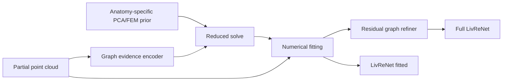

# LivReNet

**Graph-guided biomechanical reconstruction of liver surface deformation**

LivReNet estimates one 3-D displacement per vertex of a preoperative liver mesh from a partial point cloud in the same coordinate frame. A graph encoder extracts evidence from the measured points and initializes a reduced PCA/FEM solve. Numerical fitting updates the deformation against the observation. An optional multiscale graph refiner predicts a residual on the full mesh.



## Installation

The reference environment uses Python 3.10, PyTorch 2.8.0, SciPy 1.15.2 and Open3D 0.19.0. The thesis benchmark uses Linux, CUDA 12.8 and Triton 3.4. CPU execution is available for examples and small runs.

```bash
python -m pip install -e .
# On a Linux CUDA system, select a CUDA-enabled PyTorch build.
python -m pip install -e '.[cuda]'
```

## Run an example

The fixture generates a small tetrahedral volume, simulates deformations, builds the anatomy priors and samples partial point clouds. It uses artificial geometry and provides a software check.

```bash
livrenet generate --fixture --output data/fixture
livrenet predict \
  --anatomy data/fixture/anatomies/fixture_test.npz \
  --points data/fixture/test/fixture_test/fixture_test_fem_0040_0_points.npy \
  --encoder checkpoints/encoder.pt --refiner checkpoints/refiner.pt \
  --output outputs/example.npz
```

The output contains the vertex-aligned fields `solve`, `fitted` and `final` in millimetres, along with the corresponding deformed meshes. Omit `--refiner` to stop at **LivReNet fitted**. An input point cloud consists of 2,500 registered XYZ points in millimetres.

## Evaluate or train

```bash
livrenet evaluate --manifest data/fixture/test.jsonl \
  --encoder checkpoints/encoder.pt --refiner checkpoints/refiner.pt \
  --baselines --output outputs/fixture

livrenet train --train-manifest data/fixture/train.jsonl \
  --validation-manifest data/fixture/validation.jsonl \
  --primary-validation fixture_validation --epochs 1 --output runs/fixture
```

The default training configuration runs 80 encoder epochs and 40 refiner epochs. It freezes the selected encoder before generating fitted inputs for the refiner. Use `--device cuda` for the thesis backend. See the [data pipeline](docs/data.md) and [reproduction protocol](docs/reproduction.md) for the liver anatomy assets, frozen experimental split and evaluation commands.

## Thesis results

Nominal noise conditions (0 and 0.5 mm RMS) on the expanded synthetic panel. EPE is the vertex-wise Euclidean displacement error, in millimetres. Lower is better.

| System | Global EPE | Peak EPE |
| --- | ---: | ---: |
| Zero-initialized geometric fitting | 1.332 | 6.300 |
| LivReNet fitted | **1.019** | 3.908 |
| Full LivReNet | 1.061 | **2.843** |

The panel contains 3,600 observations across three fixed anatomies with anatomy-specific priors. The four noise doses reuse each camera acquisition. The [archived summaries](results/) report the higher-noise conditions, ablations and running times. The synthetic evaluation measures recovery against known displacement fields. The separate P2I-LReg analysis in the thesis measures agreement with real observed surfaces.

## Citation

Lorenzo Rosati. *LivReNet*, MSc thesis research software, 2026. See [CITATION.cff](CITATION.cff).

The [data documentation](docs/data.md) records the provenance and terms of the anatomy and sensor sources.
